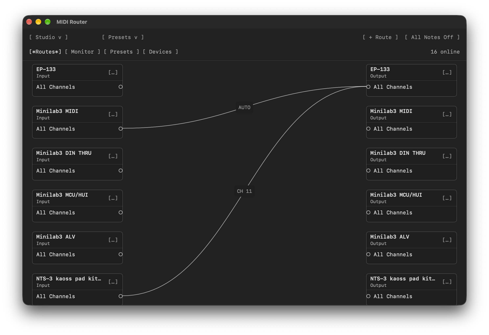
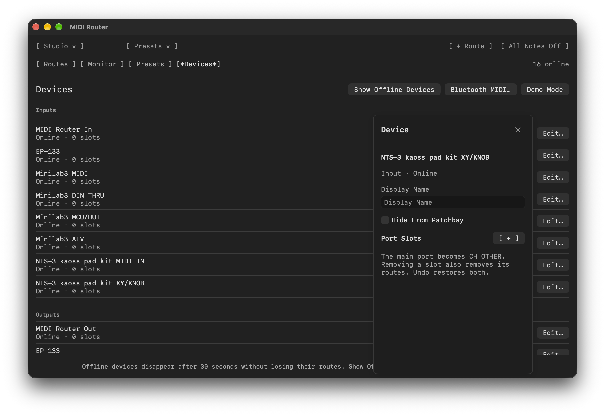
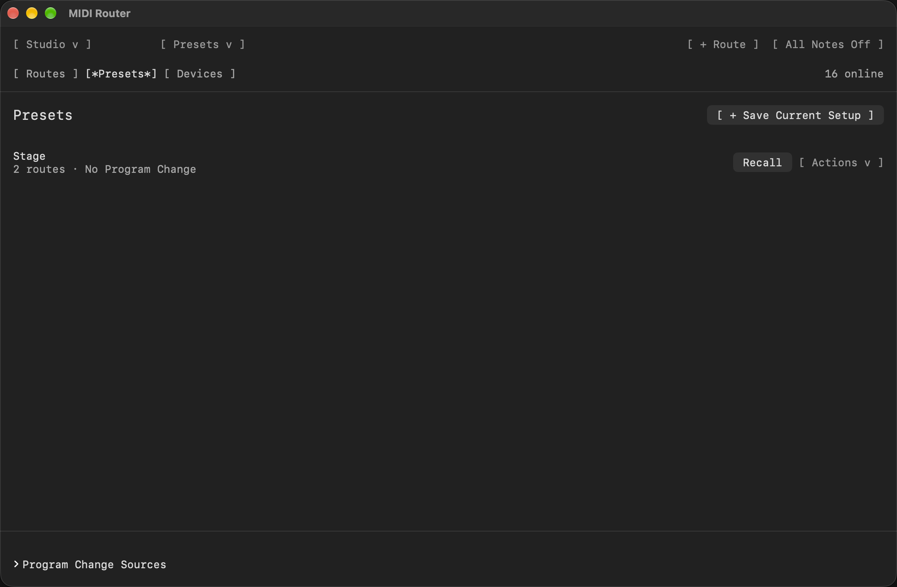
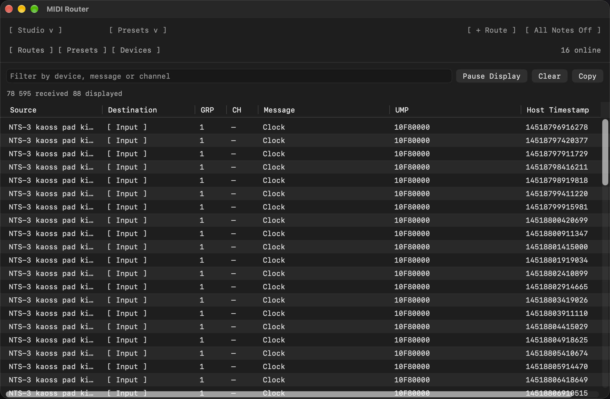

# MIDI Router

Connect keyboards, synths and music apps without opening a DAW. Draw a connection, send one controller to several instruments, and save the setup for next time.

**[Download for macOS](https://github.com/lexfrei/midi-router/releases/latest)** · [Getting started](docs/guide.md) · [Build from source](docs/building.md)

macOS 14 or later. Apple Silicon and Intel. Free and open source, with no accounts, activation, telemetry or paid feature tiers.

## Connect your gear

Drag from an input to an output to create a route. Connect the same input to another destination to layer instruments, or send several controllers to the same synth. There is no route or device limit.

Use USB MIDI devices, Bluetooth MIDI connections and virtual ports for music apps. MIDI Router handles MIDI, not audio: sound still comes from your instrument or software synth.

Click a cable to change its channel or transpose notes. **AUTO** keeps the original channel. **Port Slots** give individual channels their own connectors, so you can send different parts of a performance to different instruments. Editors open beside the connection without moving the rest of the setup.

## Keep a setup for every session

Save routes, channel slots, device names and layout as a preset. Recall it from the app or assign a Program Change message to switch from a controller.

Your session returns when you reopen the app. Unplugged devices leave the workspace without losing their routes, and reappear when they reconnect. Closing the window keeps routing running; quitting stops it. **All Notes Off** releases notes held by the router.

Preset list

## See what is connected

Choose the view that fits the setup. Studio shows inputs, outputs and cables in a patchbay. Route List provides a compact route list. Desktop lets you arrange device panels yourself, while Glass uses a patchbay with floating controls.

All views use the same routes. The interface follows macOS light and dark appearance, with adjustable text size and restrained monospaced controls. Input indicators show when MIDI reaches the Mac, even before you create a route.

Demo Mode lets you explore routing with simulated devices, without connecting any hardware. It does not send MIDI to your instruments or produce audio.

Inspect messages with the MIDI monitor

Open **View > MIDI Monitor** to inspect notes, controllers, channels and routed messages. The monitor starts paused. Turn off **Pause Display** when you need to inspect traffic, then filter or copy the log. Pausing the display never stops routing.

## Install

1. Download the universal macOS ZIP from [Releases](https://github.com/lexfrei/midi-router/releases/latest).
2. Unzip it and move **MIDI Router.app** to **Applications**.
3. Open the app, connect a MIDI device and draw a route.

This release is ad-hoc signed, not Developer ID signed or notarized. If macOS cannot verify the developer, follow [Apple's instructions for opening a trusted app](https://support.apple.com/en-us/102445): after trying to open it, use **System Settings > Privacy & Security > Open Anyway**. Do not override a warning that an app contains malware or will damage your Mac.

## Compatibility

MIDI 1.0 and native MIDI 2.0 routing are supported. MIDI 2.0 values retain their precision between compatible endpoints; legacy destinations receive what MIDI 1.0 can represent. MIDI-CI messages can pass through, but the app does not provide its own Profiles or Property Exchange service.

See the [user guide](docs/guide.md) for routing and presets, and [protocol support](docs/protocol-support.md) for compatibility limits and verification coverage.

## License

[BSD-3-Clause](LICENSE). Shared interface components are provided by [ASCIIUI](https://github.com/lexfrei/ascii-ui).
